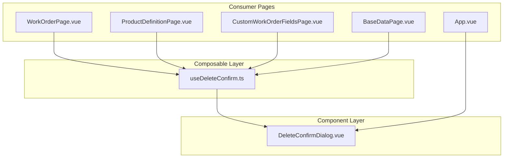

# Design Document: Delete Confirmation Dialog

## Overview

This feature introduces a unified, reusable `DeleteConfirmDialog` Vue 3 component and a companion `useDeleteConfirm` composable to replace all inconsistent delete confirmation patterns across the application. Currently, the app uses three different approaches:

1. **Native `window.confirm()`** in WorkOrderPage, ProductDefinitionPage, and CustomWorkOrderFieldsPage — showing ugly browser-native dialogs with "localhost:5173 显示"
2. **Inline `confirmState` modal** in App.vue — a custom modal with red X icon, used for route/department/user actions
3. **No confirmation at all** in BaseDataPage for unit, defect item, and process deletions

The design consolidates these into a single polished component with a promise-based composable API, ensuring consistent UX, proper accessibility, and protection against accidental deletions.

## Architecture



### Architecture Decisions

1. **Component + Composable pattern**: The `DeleteConfirmDialog` is a presentational SFC that accepts props and emits events. The `useDeleteConfirm` composable wraps it with a promise-based API for ergonomic programmatic usage. Pages can use either approach depending on their needs.

2. **v-model binding for visibility**: Using `v-model:visible` (via `update:visible` event) follows Vue 3 conventions and allows both declarative template binding and programmatic control.

3. **No global singleton / provide-inject**: Each page that needs confirmation instantiates its own dialog (or uses the composable which manages local state). This avoids global state complexity and keeps the component tree explicit.

4. **App.vue retains direct component usage**: Since App.vue already has a `confirmState` reactive pattern used by child components via `@confirm` events, it will bind `DeleteConfirmDialog` directly to `confirmState` rather than using the composable. This minimizes refactoring of the event-based pattern already in place.

## Components and Interfaces

### DeleteConfirmDialog.vue

**Location:** `frontend/src/components/DeleteConfirmDialog.vue`

**Props:**

| Prop | Type | Default | Description |
|------|------|---------|-------------|
| `visible` | `boolean` | `false` | Controls modal visibility, supports v-model |
| `title` | `string` | `"删除确认"` | Modal heading text (max 50 chars) |
| `message` | `string` | `""` | Descriptive body text (max 200 chars) |
| `loading` | `boolean` | `false` | When true, disables confirm and all dismiss actions |

**Events:**

| Event | Payload | Description |
|-------|---------|-------------|
| `update:visible` | `boolean` | Emitted with `false` on cancel/backdrop/Escape |
| `confirm` | — | Emitted when user clicks the confirm button |

**Template Structure:**

```html
<Teleport to="body">
  <Transition name="dialog-fade">
    <div v-if="visible" class="delete-confirm-backdrop" role="dialog" aria-modal="true" :aria-labelledby="titleId">
      <div class="delete-confirm-backdrop__overlay" @click="handleDismiss" />
      <section class="delete-confirm-dialog" @click.stop>
        <div class="delete-confirm-dialog__header">
          <div class="delete-confirm-dialog__icon"><!-- Red circle-X SVG --></div>
          <h2 :id="titleId" class="delete-confirm-dialog__title">{{ title }}</h2>
        </div>
        <p class="delete-confirm-dialog__message">{{ message }}</p>
        <footer class="delete-confirm-dialog__footer">
          <button class="btn btn--ghost" :disabled="loading" @click="handleDismiss" ref="cancelBtnRef">取消</button>
          <button class="btn btn--danger" :disabled="loading" @click="handleConfirm">
            <span v-if="loading" class="spinner" />
            确定
          </button>
        </footer>
      </section>
    </div>
  </Transition>
</Teleport>
```

**Key Behaviors:**
- Uses `<Teleport to="body">` to render above all other content
- Uses Vue `<Transition>` for fade/scale animation (200ms)
- Traps focus within the dialog when open
- Moves focus to cancel button on open via `nextTick` + `ref`
- Listens for `keydown.escape` on the document when visible
- All dismiss actions are no-ops when `loading` is true

### useDeleteConfirm Composable

**Location:** `frontend/src/composables/useDeleteConfirm.ts`

**Interface:**

```typescript
interface DeleteConfirmOptions {
  message: string
  title?: string // defaults to "删除确认"
}

interface UseDeleteConfirmReturn {
  visible: Ref<boolean>
  title: Ref<string>
  message: Ref<string>
  loading: Ref<boolean>
  confirm: (options: DeleteConfirmOptions) => Promise<boolean>
  handleConfirm: () => void
  handleCancel: () => void
}

export function useDeleteConfirm(): UseDeleteConfirmReturn
```

**Behavior:**
- `confirm(options)` sets `visible`, `title`, `message` and returns a `Promise<boolean>`
- The promise resolves `true` when `handleConfirm()` is called (user clicks confirm)
- The promise resolves `false` when `handleCancel()` is called (user cancels/backdrop/Escape)
- If `confirm()` is called while a previous dialog is visible, the previous promise resolves `false` immediately
- `loading` is a writable ref — the caller sets it to `true` before async operations and `false` after

**Usage Pattern in Pages:**

```vue
<script setup lang="ts">
import { useDeleteConfirm } from '@/composables/useDeleteConfirm'
import DeleteConfirmDialog from '@/components/DeleteConfirmDialog.vue'

const { visible, title, message, loading, confirm, handleConfirm, handleCancel } = useDeleteConfirm()

async function removeItem(item: Item) {
  const confirmed = await confirm({ message: `确认删除「${item.name}」？` })
  if (!confirmed) return
  loading.value = true
  try {
    await deleteApi(item.id)
    // update list...
  } finally {
    loading.value = false
    visible.value = false
  }
}
</script>

<template>
  <!-- page content -->
  <DeleteConfirmDialog
    v-model:visible="visible"
    :title="title"
    :message="message"
    :loading="loading"
    @confirm="handleConfirm"
    @update:visible="val => { if (!val) handleCancel() }"
  />
</template>
```

## Data Models

This feature is purely frontend — no new backend data models or API changes are required.

### Component State Model

```typescript
// Internal state of DeleteConfirmDialog
interface DialogInternalState {
  titleId: string          // Generated unique ID for aria-labelledby
  cancelBtnRef: Ref<HTMLButtonElement | null>  // Ref for focus management
}

// Composable internal state
interface ComposableInternalState {
  visible: Ref<boolean>
  title: Ref<string>
  message: Ref<string>
  loading: Ref<boolean>
  pendingResolve: ((value: boolean) => void) | null  // Promise resolver
}
```

### Integration Points

The following pages will be modified to use the new component:

| Page | Current Pattern | New Pattern |
|------|----------------|-------------|
| WorkOrderPage.vue | `window.confirm()` | `useDeleteConfirm` composable |
| ProductDefinitionPage.vue | `window.confirm()` | `useDeleteConfirm` composable |
| CustomWorkOrderFieldsPage.vue | `window.confirm()` | `useDeleteConfirm` composable |
| App.vue | Inline `confirmState` template | Direct `DeleteConfirmDialog` binding |
| BaseDataPage.vue | No confirmation | `useDeleteConfirm` composable |

## Correctness Properties

*A property is a characteristic or behavior that should hold true across all valid executions of a system — essentially, a formal statement about what the system should do. Properties serve as the bridge between human-readable specifications and machine-verifiable correctness guarantees.*

### Property 1: Visibility toggle correctness

*For any* boolean value of the `visible` prop, the DeleteConfirmDialog component SHALL render the modal overlay and dialog content when `visible` is `true`, and SHALL render nothing (empty DOM) when `visible` is `false`.

**Validates: Requirements 1.2**

### Property 2: Props rendering round-trip

*For any* valid title string (1-50 characters, non-empty) and any valid message string (1-200 characters), when passed as props to a visible DeleteConfirmDialog, the rendered output SHALL contain the exact title text in the heading element and the exact message text in the body paragraph.

**Validates: Requirements 1.3, 1.4**

### Property 3: Composable confirm state setup

*For any* valid `DeleteConfirmOptions` object (with a non-empty message and optional title), calling `confirm(options)` SHALL set `visible` to `true`, `title` to the provided title (or "删除确认" if omitted), and `message` to the provided message, and SHALL return a Promise that resolves to `true` when `handleConfirm()` is called or `false` when `handleCancel()` is called.

**Validates: Requirements 9.2, 9.3**

### Property 4: Concurrent invocation safety

*For any* sequence of two `confirm()` calls where the first dialog has not been resolved, the first Promise SHALL resolve to `false` before the second dialog's state is applied, ensuring no promise is left permanently pending.

**Validates: Requirements 9.5**

## Error Handling

### User-Facing Errors

| Scenario | Handling |
|----------|----------|
| Delete API call fails after confirmation | The calling page catches the error, sets `loading` back to `false`, closes the dialog, and displays an error toast (existing `errorMessage` pattern) |
| Network timeout during delete | Same as above — the `finally` block ensures loading state is reset |
| Component unmounts while dialog is open | The composable's pending promise resolves `false` via cleanup in `onUnmounted` |

### Developer Errors

| Scenario | Handling |
|----------|----------|
| `title` exceeds 50 characters | Truncated with ellipsis via CSS (`text-overflow: ellipsis`) — no runtime error |
| `message` exceeds 200 characters | Truncated with ellipsis via CSS — no runtime error |
| `confirm()` called without message | TypeScript type enforcement prevents this at compile time |
| Caller forgets to reset `loading` | Dialog remains in loading state — user can refresh page. Consider adding a timeout warning in dev mode |

### Transition Edge Cases

- If `visible` changes to `false` during the enter transition, Vue's `<Transition>` handles cancellation gracefully
- If the component is destroyed mid-animation, no memory leaks occur since event listeners are cleaned up in `onUnmounted`

## Testing Strategy

### Unit Tests (Example-Based)

Using **Vitest** + **@vue/test-utils** (to be added as dev dependencies):

1. **Component rendering tests:**
   - Renders nothing when `visible` is false
   - Renders modal with correct structure when `visible` is true
   - Displays default title "删除确认" when title prop not provided
   - Displays custom title and message from props
   - Shows loading spinner and disables confirm button when `loading` is true

2. **Interaction tests:**
   - Emits `confirm` event on confirm button click
   - Emits `update:visible` with `false` on cancel button click
   - Emits `update:visible` with `false` on backdrop click
   - Emits `update:visible` with `false` on Escape key press
   - Does NOT emit any events when `loading` is true

3. **Accessibility tests:**
   - Has `role="dialog"` and `aria-modal="true"`
   - Has `aria-labelledby` pointing to title element
   - Focus moves to cancel button on open

4. **Composable tests:**
   - `confirm()` sets reactive state correctly
   - Promise resolves `true` on handleConfirm
   - Promise resolves `false` on handleCancel
   - Concurrent calls resolve previous promise with `false`
   - Cleanup on unmount resolves pending promise with `false`

### Property-Based Tests

Using **fast-check** with Vitest:

- Minimum 100 iterations per property test
- Each test tagged with: **Feature: delete-confirmation-dialog, Property {N}: {description}**

**Property tests to implement:**
1. Visibility toggle (Property 1) — generate random booleans, verify render/no-render
2. Props rendering round-trip (Property 2) — generate random strings within length bounds, verify they appear in rendered output
3. Composable confirm state setup (Property 3) — generate random options, verify state and promise behavior
4. Concurrent invocation safety (Property 4) — generate random sequences of confirm calls, verify previous promises resolve false

### Integration Tests

Manual verification checklist for each page integration:
- WorkOrderPage: single delete, batch delete, confirm flow, cancel flow
- ProductDefinitionPage: delete with product name, confirm, cancel
- CustomWorkOrderFieldsPage: delete with field name, confirm, cancel
- App.vue: existing confirmState pattern still works with new component
- BaseDataPage: unit/defect/process delete now shows confirmation

### Dependencies to Add

```json
{
  "devDependencies": {
    "vitest": "^3.0.0",
    "@vue/test-utils": "^2.4.0",
    "fast-check": "^3.0.0",
    "jsdom": "^24.0.0"
  }
}
```
