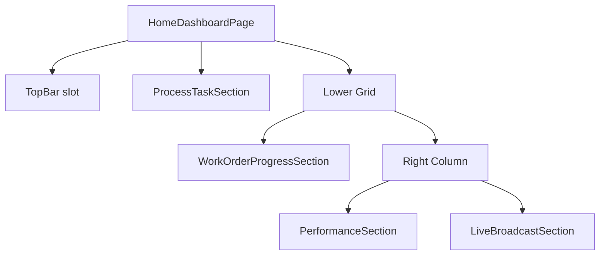

# Design Document

## Overview

主页仪表盘（Home_Dashboard）是电脑端管理员账号登录后默认显示的常驻业务首页，与现有的"车间看板"（DashboardPage.vue）共存但相互独立。本设计在不破坏既有数据模型的前提下，复用 `WorkOrder`、`WorkOrderReport`、`Process` 三个核心实体，并通过新增一个聚合查询控制器 `HomeDashboardController` 提供四个区块所需的数据，前端使用一个新的 Vue 单文件组件 `HomeDashboardPage.vue` 装配四个子区块。

设计目标：

- 主页四个区块（工序任务、工单进度报表、绩效指标、生产实时播报）由同一个 Vue 页面装配，通过独立的接口拉取，互不阻塞。
- 工序任务卡片设置通过现有 `/api/user/preferences/{key}` 持久化，无需新增表。
- 时间范围（today / yesterday / this_month）作为后端查询参数，统计逻辑集中在后端服务，避免前端重复实现。
- 工单"完成"时间维度在现有 `WorkOrder` 实体中增加可空字段 `completedAt`，并在 `WorkOrderService.update` 中当 `status` 从非 `COMPLETED` 变更为 `COMPLETED` 时写入当前时间，保持向前兼容。
- 生产实时播报采用前端定时拉取的方案（30 秒一次），后端不引入 WebSocket，简化部署。

## Architecture

### 总体结构

```mermaid
flowchart LR
    subgraph Frontend[Vue Frontend]
        HD[HomeDashboardPage.vue]
        HD --> PTS[ProcessTaskSection.vue]
        HD --> WOPS[WorkOrderProgressSection.vue]
        HD --> PIS[PerformanceSection.vue]
        HD --> LBS[LiveBroadcastSection.vue]
        PTS --> PCSM[ProcessCardSettingsModal.vue]
    end

    subgraph Backend[Spring Boot]
        HDC[HomeDashboardController]
        UPC[UserPreferenceController existing]
        HDS[HomeDashboardService]
        UPS[UserPreferenceService existing]
        HDC --> HDS
        UPC --> UPS
    end

    subgraph DB[(MySQL)]
        WO[work_orders]
        WOR[work_order_reports]
        P[processes]
        UP[user_preferences]
    end

    HD -- GET /api/home-dashboard/process-cards --> HDC
    HD -- GET /api/home-dashboard/work-orders --> HDC
    HD -- GET /api/home-dashboard/performance --> HDC
    HD -- GET /api/home-dashboard/reports/recent --> HDC
    HD -- GET/PUT /api/user/preferences/home_dashboard.process_cards --> UPC

    HDS --> WO
    HDS --> WOR
    HDS --> P
    UPS --> UP
```

### 路由与权限

- 前端在登录成功后（用户名密码登录与手机号登录两条链路）若 `currentUser.role === 'ADMIN'` 则将 `activeMainMenu` 设为新加的 `'home'` 视图；否则保持现有逻辑（用户管理 / 移动端登录限制）。
- 侧边栏顶部新增"主页"导航项，仅在 `currentUser.role === 'ADMIN'` 时渲染并默认选中。
- 所有 `/api/home-dashboard/**` 接口走现有 `TokenService.requireAdmin(authorization)` 校验，非管理员返回 403；未携带 token 返回 401。前端 `request<T>` 包装函数在拦截到 401/403 后由调用方处理（清除 token / 隐藏区块）。

### 数据流

1. `HomeDashboardPage` 挂载时并发触发四个请求：
   - 加载用户偏好 `home_dashboard.process_cards`，再加载工序卡片数据；
   - 加载工单进度报表（默认"未开始"标签）；
   - 加载绩效指标；
   - 加载最近 20 条报工记录。
2. `Process_Task_Section` 内部维护 `range`（`today`/`yesterday`/`this_month`，默认 `today`）与 `includeNotStarted`（默认 false）两个本地状态；当任一变化时重新拉取工序卡片，并将 `range` 通过 `provide/inject` 共享给 `Performance_Section`。
3. `Live_Broadcast` 组件挂载时启动 `setInterval` 定时器，每 30 秒以 `since=lastReportCreatedAt` 拉取增量；组件 `onUnmounted` 与父页面 `activeMainMenu` 切换时清除定时器。

## Components and Interfaces

### 后端：HomeDashboardController

| 路径 | 方法 | 入参 | 出参 | 备注 |
| --- | --- | --- | --- | --- |
| `/api/home-dashboard/process-cards` | GET | `range`(today/yesterday/this_month, default today)，`includeNotStarted`(default false) | `ProcessCardListResponse` | 仅返回数据，过滤展示由前端按用户偏好完成 |
| `/api/home-dashboard/work-orders` | GET | `status`(`not_started`/`in_progress`/`due_within_3_days`/`overdue_unfinished`/`overdue_finished_this_month`/`finished_today`/`finished_this_month`) | `WorkOrderProgressListResponse` | 不分页，最多 500 行 |
| `/api/home-dashboard/performance` | GET | `range` | `PerformanceResponse` | 6 项指标 |
| `/api/home-dashboard/reports/recent` | GET | `since`(可选 ISO 时间，缺省返回最新 20 条)，`limit`(默认 20，上限 50) | `RecentReportListResponse` | 用于初始加载与轮询增量 |

控制器统一调用 `tokenService.requireAdmin(authorization)`，从中拿到 `factoryId`；服务层方法签名为 `(Long factoryId, ...)`，禁止跨工厂访问。

### 后端：HomeDashboardService

```java
public class HomeDashboardService {
    ProcessCardListResponse listProcessCards(Long factoryId, TimeRange range, boolean includeNotStarted);
    WorkOrderProgressListResponse listWorkOrders(Long factoryId, WorkOrderStatusTab tab, LocalDateTime now);
    PerformanceResponse getPerformance(Long factoryId, TimeRange range, LocalDateTime now);
    RecentReportListResponse listRecentReports(Long factoryId, LocalDateTime since, int limit);
}
```

其中：

- `TimeRange` 枚举：`TODAY`/`YESTERDAY`/`THIS_MONTH`，提供 `Pair<LocalDateTime,LocalDateTime> toInterval(LocalDateTime now)`。约定 `today=[00:00,次日00:00)`、`yesterday=[昨日00:00,今日00:00)`、`this_month=[本月1日00:00,下月1日00:00)`。
- `WorkOrderStatusTab` 枚举对应 7 个标签，提供 `Predicate<WorkOrder> matches(LocalDateTime now)`。
- 所有时间窗口的右端点开区间，避免边界重复计入。
- 聚合查询全部走 JPA 的 `@Query` 自定义聚合 SQL，避免在内存里过滤大集合。

### 后端：WorkOrder 模型变更

`WorkOrder` 新增字段：

```java
@Column(name = "completed_at")
private LocalDateTime completedAt;
```

并在 `WorkOrderService.applyRequest` 中添加：

```java
String previousStatus = creating ? null : workOrder.getStatus();
String nextStatus = ...;  // 已有逻辑解析
workOrder.setStatus(nextStatus);
if (!"COMPLETED".equals(previousStatus) && "COMPLETED".equals(nextStatus)) {
    workOrder.setCompletedAt(LocalDateTime.now());
}
if (!"COMPLETED".equals(nextStatus)) {
    workOrder.setCompletedAt(null);  // 撤回完成时清空
}
```

数据库迁移脚本需要新增列 `completed_at DATETIME NULL`，并对存量 `status='COMPLETED'` 的记录用 `updated_at` 回填一次。

### 前端组件：HomeDashboardPage.vue



- `HomeDashboardPage` 提供顶层 `provide('homeRange', range)`，由 `ProcessTaskSection` 写入、`PerformanceSection` 读取，避免跨组件状态库。
- `ProcessTaskSection`：使用 `useUserPreference('home_dashboard.process_cards')` composable 加载并保存设置；维护 `range`、`includeNotStarted`、`cards`、`loading`、`errorMessage` 等本地状态；在请求失败时设置 `errorMessage` 但不清空 `cards`。
- `ProcessCardSettingsModal`：受控组件，`v-model:visible` + `:settings`，`emit('save', newSettings)`。内部使用 HTML5 拖拽 API 与上下移动按钮（参考现有 `WorkOrderPage.vue` 中 `routeForm.steps` 的模式）。
- `WorkOrderProgressSection`：内部维护 `tab`（默认 `not_started`）与 `sortField`/`sortOrder`；表格基于现有项目里通用 `<table>` 模式（与 `BaseDataPage.vue` 一致）。"查看"链接通过 `emit('view', workOrderId)` 由父级路由到现有的工单详情页（`activeMainMenu='production'`，并通过新的事件 `selectWorkOrder` 在工单页打开详情抽屉）。
- `PerformanceSection`：响应注入的 `homeRange`，使用六个 `KpiTile`。
- `LiveBroadcastSection`：维护 `reports: WorkOrderReportInfo[]`、`pollingTimerId`，`onMounted` 启动定时器，`onBeforeUnmount` 与 `watch(activeMainMenu)` 清除。

### 前端 API 扩展（api.ts）

新增类型与函数：

```ts
export type HomeRange = 'today' | 'yesterday' | 'this_month'
export type WorkOrderStatusTab =
  | 'not_started' | 'in_progress' | 'due_within_3_days'
  | 'overdue_unfinished' | 'overdue_finished_this_month'
  | 'finished_today' | 'finished_this_month'

export interface ProcessCardItem {
  processId: number
  processName: string
  taskCount: number      // 生产任务数
  plannedQuantity: number
  goodQuantity: number
  defectQuantity: number
}
export interface ProcessCardListResponse { items: ProcessCardItem[] }

export interface WorkOrderProgressItem {
  id: number
  code: string
  productCode: string
  productName: string
  productSpec: string
  status: string
  statusLabel: string
}
export interface WorkOrderProgressListResponse { items: WorkOrderProgressItem[] }

export interface PerformanceResponse {
  plannedQuantity: number
  completedQuantity: number
  workOrderCount: number
  defectRatePercent: number   // 已包含百分比真实数值，前端只需 toFixed(2)
  averageCycleDays: number    // 已四舍五入到 1 位小数
  overdueUnfinishedCount: number
}

export interface RecentReportItem {
  id: number
  workOrderId: number
  workOrderCode: string
  reporterName: string
  processName: string
  goodQuantity: number
  defectQuantity: number
  createdAt: string  // 后端已格式化为 yyyy-MM-dd HH:mm:ss
}
export interface RecentReportListResponse { items: RecentReportItem[] }

export function fetchHomeProcessCards(token: string, range: HomeRange, includeNotStarted: boolean): Promise<ProcessCardListResponse>
export function fetchHomeWorkOrders(token: string, tab: WorkOrderStatusTab): Promise<WorkOrderProgressListResponse>
export function fetchHomePerformance(token: string, range: HomeRange): Promise<PerformanceResponse>
export function fetchHomeRecentReports(token: string, params: { since?: string; limit?: number }): Promise<RecentReportListResponse>
```

所有函数复用现有 `request<T>(...)`；当 `request` 抛错且 HTTP 状态可识别为 401/403 时，抛出带 `code` 字段的 `ApiError`，由上层 `useAuth().logout()` 或区块的隐藏逻辑处理。为此 `request` 工具函数的错误对象会扩展为：

```ts
class ApiError extends Error {
  status: number
  constructor(message: string, status: number) { super(message); this.status = status }
}
```

### 用户偏好结构（home_dashboard.process_cards）

```json
{
  "version": 1,
  "items": [
    { "processId": 12, "color": "#3B82F6", "visible": true },
    { "processId": 7, "color": "#9CA3AF", "visible": true },
    { "processId": 3, "color": "#FACC15", "visible": false }
  ]
}
```

- 数组顺序即为卡片展示顺序。
- `visible=false` 的工序保留在配置中但不渲染（用户取消勾选）。
- 当后端工序列表中存在 `processId` 未出现在该数组的工序时，前端将其追加到末尾，`visible=false`、颜色取默认色板循环值，但不主动写回偏好（除非用户在设置弹窗中保存）。
- 若 `User_Preference_Store` 返回 404（即不存在该 key），前端按"默认前 4 个工序 + 蓝灰黄绿"生成内存中的 settings，但不主动写回（保持懒持久化语义，与既有偏好接口一致）。

## Data Models

### 实体

#### WorkOrder（修改）

| 字段 | 类型 | 说明 |
| --- | --- | --- |
| 已有字段 | 见 `model/WorkOrder.java` | 不变 |
| `completedAt` | `LocalDateTime`，nullable | 当 `status` 从其他状态变更为 `COMPLETED` 时由 `WorkOrderService` 写入；从 `COMPLETED` 离开时清空 |

#### Process（不变）

工序基础信息以现有 `processes` 表为准。

#### WorkOrderReport（不变）

报工记录字段已满足实时播报与绩效指标的统计需求：`createdAt`、`reporterName`、`processName`、`workOrderCode`、`goodQuantity`、`defectQuantity`。

#### UserPreference（不变）

通过 `user_preferences` 表 `(user_id, pref_key='home_dashboard.process_cards', pref_value=JSON)` 存储。

### DTO

新增 DTO 类（位于 `com.heihu.workorder.dto`）：

- `ProcessCardItemResponse` / `ProcessCardListResponse`
- `WorkOrderProgressItemResponse` / `WorkOrderProgressListResponse`
- `PerformanceResponse`
- `RecentReportItemResponse` / `RecentReportListResponse`

字段命名与上文 TS 接口一一对应。

### 时间范围与状态过滤的统一定义

| 概念 | 定义 |
| --- | --- |
| `now` | 调用接口时刻（UTC+8 工厂本地时区，由后端注入 `Clock`） |
| `today` | `[date(now) 00:00:00, date(now)+1日 00:00:00)` |
| `yesterday` | `[date(now)-1日 00:00:00, date(now) 00:00:00)` |
| `this_month` | `[本月1日 00:00:00, 下月1日 00:00:00)` |
| `due_within_3_days` 标签 | `status != 'COMPLETED' AND planEnd ∈ [now, date(now)+3日 23:59:59.999]` |
| `overdue_unfinished` 标签 | `status != 'COMPLETED' AND planEnd < now` |
| `overdue_finished_this_month` 标签 | `status = 'COMPLETED' AND completedAt ∈ this_month AND completedAt > planEnd` |
| `finished_today` 标签 | `status = 'COMPLETED' AND completedAt ∈ today` |
| `finished_this_month` 标签 | `status = 'COMPLETED' AND completedAt ∈ this_month` |

### 绩效指标计算口径

| 指标 | 公式 |
| --- | --- |
| 计划数 | `Σ WorkOrder.plannedQuantity WHERE createdAt ∈ range` |
| 完成数量 | `Σ WorkOrderReport.goodQuantity WHERE createdAt ∈ range` |
| 工单数量 | `count(WorkOrder) WHERE createdAt ∈ range` |
| 不良品率 | `Σ defectQuantity / (Σ goodQuantity + Σ defectQuantity) × 100`，结果四舍五入保留 2 位小数；分母为 0 返回 0.00；> 100 不截断 |
| 平均工单生产周期 | `avg((completedAt - createdAt).toDays()) WHERE status = 'COMPLETED' AND createdAt ∈ range`，结果四舍五入保留 1 位小数；无符合记录返回 0.0 |
| 超期未完成工单 | `count(WorkOrder) WHERE status != 'COMPLETED' AND planEnd < now`（不受 `range` 影响） |

### 工序卡片"生产任务数"口径

工单的 `task_data_json` 中每个 `TaskItem` 视为一个"生产任务"。"生产任务数"按以下规则统计：

- 取选中 `range` 内 `WorkOrder.createdAt` 落入区间的工单（与绩效指标的工单选择一致）；
- 展开每个工单的 `tasks`，按 `processName` 聚合；
- 每条任务计入对应工序：
  - `taskCount += 1`
  - `plannedQuantity += task.plannedQuantity`
  - `goodQuantity += task.approvedQuantity`（已审批的良品）
  - `defectQuantity += task.defectQuantity`
- 当 `includeNotStarted=false` 时排除 `task.completedQuantity == 0` 且 `task.lastReportTime == null` 的任务；当 `includeNotStarted=true` 时全部计入。
- 工序列表来自 `processes` 表中的工序名匹配（按 `factoryId + name` 命中）；偏好设置仅决定前端展示哪些工序，后端返回所有命中工序的数据。

<!-- 后续小节将在 Correctness Properties 写完后再追加 -->


## Error Handling

### 前端错误处理

| 场景 | 处理方式 |
| --- | --- |
| 任一接口返回 HTTP 401 | 调用 `useAuth().logout()`，清除本地 token 并跳转登录页 |
| 任一接口返回 HTTP 403 | 隐藏所有数据区块，尝试显示"无权限访问主页"提示 |
| 工序卡片接口请求失败（非 401/403） | 保留上一次成功数据，在卡片区上方显示"加载失败"提示文字；首次加载失败时仅显示提示文字 |
| 工单进度报表接口请求失败 | 表格区域显示"加载失败，请重试"提示 |
| 绩效指标接口请求失败 | 各指标显示 `--` 占位 |
| 实时播报接口请求失败 | 静默忽略，保留当前列表，下次轮询继续尝试 |
| 用户偏好接口返回 404 | 使用默认配置（前 4 个工序 + 预设颜色），不写回 |

### 后端错误处理

| 场景 | 处理方式 |
| --- | --- |
| `range` 参数不合法 | 返回 400 Bad Request，body 为 `ErrorResponse` |
| `tab` 参数不合法 | 返回 400 Bad Request |
| Token 缺失或无效 | 返回 401 Unauthorized |
| Token 对应用户非 ADMIN | 返回 403 Forbidden |
| 数据库查询异常 | 返回 500 Internal Server Error，日志记录异常堆栈 |

## Correctness Properties

1. **时间窗口互斥性**：`today`、`yesterday`、`this_month` 三个时间窗口中，`today` 与 `yesterday` 互不重叠；`this_month` 包含 `today` 与 `yesterday`。
2. **进度百分比有界性**：进度条宽度 ∈ [0%, 100%]，即使计算值 > 100% 也限定为 100%。
3. **不良品率非负性**：不良品率 ≥ 0.00%，分母为 0 时返回 0.00%。
4. **工单状态标签互斥性**：同一工单在同一时刻最多出现在一个状态标签下（`not_started`、`in_progress` 互斥；`finished_today` ⊂ `finished_this_month`；`overdue_finished_this_month` ⊂ `finished_this_month`）。
5. **completedAt 一致性**：`status = COMPLETED` 时 `completedAt` 非空；`status ≠ COMPLETED` 时 `completedAt` 为空。
6. **轮询幂等性**：以相同 `since` 参数多次调用 `reports/recent` 接口，在无新数据写入时返回相同结果。
7. **工厂隔离性**：所有查询均按 `factoryId` 过滤，不同工厂数据不可交叉访问。
8. **偏好持久化幂等性**：连续两次以相同配置保存偏好，第二次保存后读取结果与第一次一致。

## Testing Strategy

### 后端测试

| 层级 | 范围 | 工具 |
| --- | --- | --- |
| 单元测试 | `HomeDashboardService` 各方法的时间窗口计算、状态过滤、指标聚合 | JUnit 5 + Mockito |
| 集成测试 | `HomeDashboardController` 端到端（含权限校验、参数校验、数据库查询） | Spring Boot Test + H2 |
| 属性测试 | 时间窗口边界、不良品率计算、进度百分比有界性 | jqwik |

### 前端测试

| 层级 | 范围 | 工具 |
| --- | --- | --- |
| 组件测试 | 各 Section 组件的渲染、交互、错误状态 | Vitest + Vue Test Utils |
| API Mock 测试 | `api.ts` 新增函数的请求参数与响应解析 | Vitest + MSW |
| E2E 测试 | 登录后进入主页、切换时间范围、设置弹窗保存 | Playwright |

### 关键测试场景

1. 时间范围切换后工序卡片数据刷新
2. 工单状态标签切换后表格数据正确过滤
3. 不良品率分母为 0 时显示 0.00%
4. 进度百分比 > 100% 时进度条宽度限定为 100%
5. 轮询增量追加且列表不超过 20 条
6. 401 响应触发登出、403 响应隐藏区块
7. `completedAt` 在状态变更时正确写入/清空
8. 用户偏好不存在时使用默认配置
