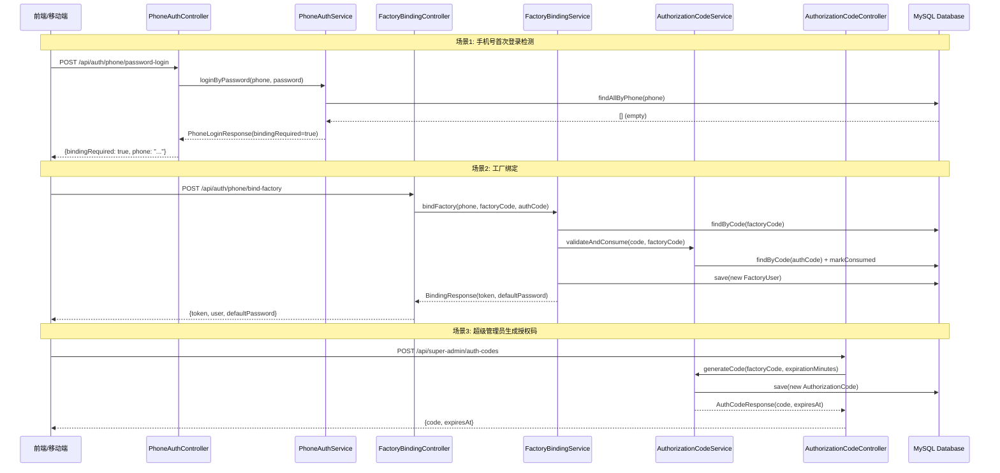

# Design Document: Phone Factory Binding

## Overview

本设计实现手机号首次登录时绑定工厂的完整流程。核心变更是修改现有的 `PhoneAuthService`，当检测到手机号无关联 `FactoryUser` 记录时，不再抛出"未注册"错误，而是返回 `bindingRequired` 标志引导用户进入绑定流程。

绑定流程涉及三个核心服务：
1. **PhoneAuthService（修改）**：增加首次登录检测逻辑
2. **FactoryBindingService（新增）**：处理工厂绑定请求，验证授权码并创建用户
3. **AuthorizationCodeService（新增）**：管理授权码的生成、存储和验证

系统通过授权码机制确保绑定安全性：超级管理员为指定工厂生成带有效期的一次性授权码，工厂负责人使用该授权码完成绑定后成为工厂的第一个管理员。

## Architecture



### 设计决策

1. **超级管理员认证方式**：使用独立的 API Key 认证（通过 `X-Super-Admin-Key` 请求头），与现有的 Token 认证体系分离。理由：超级管理员是开发者角色，不属于任何工厂，无法使用现有的 FactoryUser Token 体系。

2. **授权码存储**：使用新的 `authorization_codes` 数据库表存储，而非内存缓存。理由：需要持久化、支持查询历史记录、支持多实例部署。

3. **并发控制**：使用数据库乐观锁（version 字段）确保同一授权码不会被并发消费。理由：简单可靠，符合现有项目的 JPA 使用模式。

4. **默认密码**：绑定成功后生成固定 6 位默认密码并返回给前端显示。理由：简化首次使用体验，用户可后续修改密码。

## Components and Interfaces

### 新增 Controller

#### FactoryBindingController
- **路径**: `/api/auth/phone/bind-factory`
- **职责**: 接收绑定请求，调用 FactoryBindingService

```java
@RestController
@RequestMapping("/api/auth/phone")
public class FactoryBindingController {
    @PostMapping("/bind-factory")
    public BindingResponse bindFactory(@Valid @RequestBody BindFactoryRequest request);
}
```

#### AuthorizationCodeController
- **路径**: `/api/super-admin/auth-codes`
- **职责**: 超级管理员授权码管理（生成、列表查询）

```java
@RestController
@RequestMapping("/api/super-admin/auth-codes")
public class AuthorizationCodeController {
    @PostMapping
    public AuthCodeResponse generateCode(
        @RequestHeader("X-Super-Admin-Key") String adminKey,
        @Valid @RequestBody GenerateAuthCodeRequest request);

    @GetMapping
    public List<AuthCodeListItem> listCodes(
        @RequestHeader("X-Super-Admin-Key") String adminKey,
        @RequestParam String factoryCode);
}
```

### 新增 Service

#### FactoryBindingService
- **职责**: 编排绑定流程（验证工厂、验证授权码、创建用户、生成密码、发放 Token）

```java
@Service
public class FactoryBindingService {
    public BindingResponse bindFactory(String phone, String factoryCode, String authorizationCode);
}
```

#### AuthorizationCodeService
- **职责**: 授权码生成、存储、验证、消费

```java
@Service
public class AuthorizationCodeService {
    public AuthCodeResponse generateCode(String factoryCode, Integer expirationMinutes);
    public void validateAndConsume(String code, String factoryCode);
    public List<AuthCodeListItem> listByFactory(String factoryCode);
}
```

### 修改现有 Service

#### PhoneAuthService（修改）
- **变更**: `loginByPassword` 和 `loginBySmsCode` 方法中，当 `findAllByPhone` 返回空列表时，不再抛出异常，而是返回 `bindingRequired=true` 的响应。

### 新增 DTO

| DTO | 用途 |
|-----|------|
| `BindFactoryRequest` | 绑定请求：phone, factoryCode, authorizationCode |
| `BindingResponse` | 绑定响应：token, user, defaultPassword |
| `GenerateAuthCodeRequest` | 生成授权码请求：factoryCode, expirationMinutes(可选) |
| `AuthCodeResponse` | 生成授权码响应：code, expiresAt |
| `AuthCodeListItem` | 授权码列表项：code, status, createdAt, expiresAt |

### API 端点汇总

| Method | Path | Auth | Description |
|--------|------|------|-------------|
| POST | `/api/auth/phone/password-login` | 无 | 手机号密码登录（修改：增加 bindingRequired） |
| POST | `/api/auth/phone/sms-login` | 无 | 手机号短信登录（修改：增加 bindingRequired） |
| POST | `/api/auth/phone/bind-factory` | 无 | 工厂绑定 |
| POST | `/api/super-admin/auth-codes` | X-Super-Admin-Key | 生成授权码 |
| GET | `/api/super-admin/auth-codes?factoryCode=xxx` | X-Super-Admin-Key | 查询授权码列表 |

## Data Models

### 新增实体：AuthorizationCode

```java
@Entity
@Table(name = "authorization_codes")
public class AuthorizationCode {
    @Id
    @GeneratedValue(strategy = GenerationType.IDENTITY)
    private Long id;

    @Column(nullable = false, unique = true, length = 8)
    private String code;  // 8位字母数字

    @ManyToOne(fetch = FetchType.LAZY)
    @JoinColumn(name = "factory_id", nullable = false)
    private Factory factory;

    @Column(nullable = false)
    private LocalDateTime createdAt;

    @Column(nullable = false)
    private LocalDateTime expiresAt;

    @Column(nullable = false)
    private boolean consumed;  // 是否已使用

    @Column
    private LocalDateTime consumedAt;  // 使用时间

    @Version
    private Integer version;  // 乐观锁，防止并发消费
}
```

### 数据库 DDL

```sql
CREATE TABLE authorization_codes (
    id BIGINT AUTO_INCREMENT PRIMARY KEY,
    code VARCHAR(8) NOT NULL UNIQUE,
    factory_id BIGINT NOT NULL,
    created_at DATETIME NOT NULL,
    expires_at DATETIME NOT NULL,
    consumed BOOLEAN NOT NULL DEFAULT FALSE,
    consumed_at DATETIME NULL,
    version INT DEFAULT 0,
    CONSTRAINT fk_auth_code_factory FOREIGN KEY (factory_id) REFERENCES factories(id)
);

CREATE INDEX idx_auth_code_factory ON authorization_codes(factory_id);
CREATE INDEX idx_auth_code_code ON authorization_codes(code);
```

### 新增 Repository

```java
public interface AuthorizationCodeRepository extends JpaRepository<AuthorizationCode, Long> {
    Optional<AuthorizationCode> findByCode(String code);
    List<AuthorizationCode> findByFactoryIdOrderByCreatedAtDesc(Long factoryId);
}
```

### PhoneLoginResponse 修改

在现有 `PhoneLoginResponse` 中增加字段：

```java
private boolean bindingRequired;  // 是否需要绑定工厂
private String phone;             // 需要绑定的手机号（bindingRequired=true 时返回）
```

### 配置项

在 `application.properties` 中增加：

```properties
app.super-admin.key=<配置的超级管理员API密钥>
app.binding.default-password-length=6
```

## Correctness Properties

*A property is a characteristic or behavior that should hold true across all valid executions of a system—essentially, a formal statement about what the system should do. Properties serve as the bridge between human-readable specifications and machine-verifiable correctness guarantees.*

### Property 1: Unregistered phone returns bindingRequired without credential validation

*For any* phone number that has no associated FactoryUser records and *for any* password string, calling `loginByPassword(phone, password)` SHALL return a response with `bindingRequired=true`, the phone number included, and no token or user information — regardless of the password value.

**Validates: Requirements 1.1, 1.3, 1.6**

### Property 2: Registered phone proceeds with normal login flow

*For any* phone number that has at least one associated FactoryUser record, calling `loginByPassword(phone, password)` SHALL NOT return `bindingRequired=true` and SHALL proceed with password validation.

**Validates: Requirements 1.2**

### Property 3: SMS login with valid code for unregistered phone returns bindingRequired

*For any* phone number that has no associated FactoryUser records and *for any* valid SMS verification code, calling `loginBySmsCode(phone, code)` SHALL return a response with `bindingRequired=true` and the phone number included.

**Validates: Requirements 1.4**

### Property 4: SMS login with invalid code for unregistered phone returns auth error without revealing binding state

*For any* phone number that has no associated FactoryUser records and *for any* invalid SMS verification code, calling `loginBySmsCode(phone, code)` SHALL throw an authentication error that does NOT contain `bindingRequired` information.

**Validates: Requirements 1.5**

### Property 5: Successful binding creates correct FactoryUser and returns token with default password

*For any* valid binding request (valid phone, existing factory code, valid unexpired unconsumed auth code, factory has no non-virtual users), the created FactoryUser SHALL have role=ADMIN, enabled=true, virtualUser=false, username=phone, name=phone, phone=phone, and the response SHALL contain a non-null token and a 6-character defaultPassword whose bcrypt hash matches the stored passwordHash.

**Validates: Requirements 2.1, 2.5, 2.6, 2.7, 6.1**

### Property 6: Auth code factory mismatch causes rejection

*For any* authorization code associated with factory A and *for any* different factory B, attempting to bind using that code with factory B's code SHALL be rejected with an invalid authorization code error.

**Validates: Requirements 2.3**

### Property 7: Expired auth code causes rejection

*For any* authorization code whose expiration time is before the current server time, attempting to validate that code SHALL be rejected with an expiration error.

**Validates: Requirements 2.4**

### Property 8: Already-bound factory rejects new binding

*For any* factory that already has at least one FactoryUser with virtualUser=false, *for any* new binding request targeting that factory SHALL be rejected with an "already bound" error.

**Validates: Requirements 2.8**

### Property 9: Auth code consumption is atomic — only one concurrent request succeeds

*For any* valid authorization code, if two concurrent binding requests submit the same code, exactly one SHALL succeed and the other SHALL receive a "code already used" error.

**Validates: Requirements 4.2, 4.3, 4.5**

### Property 10: Generated auth codes are exactly 8 alphanumeric characters with correct expiration

*For any* valid code generation request with factoryCode and expirationMinutes in [1, 1440], the generated code SHALL be exactly 8 characters long, contain only alphanumeric characters [a-zA-Z0-9], and have an expiration time equal to creation time plus the specified minutes.

**Validates: Requirements 3.1, 3.3, 3.4**

### Property 11: Out-of-range expiration minutes causes rejection

*For any* expiration minutes value less than 1 or greater than 1440, the code generation request SHALL be rejected with a range error.

**Validates: Requirements 3.6**

### Property 12: Non-super-admin requests to auth code endpoints are rejected

*For any* request to authorization code management endpoints (generate or list) that does NOT include a valid `X-Super-Admin-Key` header, the request SHALL be rejected with an authentication failure error.

**Validates: Requirements 5.1, 5.2**

### Property 13: Auth code listing returns complete sorted results

*For any* factory with N authorization codes, a list request SHALL return exactly N items, each containing code, status (active/expired/consumed), createdAt, and expiresAt, sorted by createdAt in descending order.

**Validates: Requirements 5.3**

### Property 14: Default password round-trip — binding password works for login

*For any* successful binding, the returned `defaultPassword` value, when used as the password in a subsequent `loginByPassword(phone, defaultPassword)` call, SHALL successfully authenticate and return a token.

**Validates: Requirements 6.1, 6.2**

## Error Handling

### 错误响应格式

沿用现有 `ApiException` + `GlobalExceptionHandler` 模式，所有错误返回统一 JSON 格式：

```json
{
  "message": "错误描述",
  "status": 400
}
```

### 错误场景汇总

| 场景 | HTTP Status | 错误消息 |
|------|-------------|----------|
| 绑定请求缺少必填字段 | 400 | "工厂代码和授权码不能为空" |
| 工厂代码不存在 | 400 | "工厂代码无效" |
| 授权码无效（不存在/不匹配） | 400 | "授权码无效" |
| 授权码已过期 | 400 | "授权码已过期" |
| 授权码已被使用 | 400 | "授权码已被使用" |
| 工厂已被绑定 | 400 | "该工厂已被绑定" |
| 手机号已绑定该工厂 | 400 | "该手机号已绑定此工厂" |
| 超级管理员密钥无效 | 401 | "认证失败" |
| 有效期超出范围 | 400 | "有效期必须在1-1440分钟之间" |
| 乐观锁冲突（并发消费） | 409 | "授权码已被使用" |

### 事务管理

- `FactoryBindingService.bindFactory()` 使用 `@Transactional` 注解，确保授权码消费和用户创建在同一事务中
- 如果密码哈希存储失败，整个事务回滚，不会创建 FactoryUser
- 乐观锁冲突时抛出 `OptimisticLockException`，由 GlobalExceptionHandler 转换为 409 响应

## Testing Strategy

### 属性测试（Property-Based Testing）

使用项目已有的 **jqwik** 库（版本 1.7.4）进行属性测试。

**配置要求**：
- 每个属性测试最少运行 100 次迭代
- 每个测试方法注释引用对应的设计属性
- 标签格式：`Feature: phone-factory-binding, Property {number}: {property_text}`

**测试范围**：
- Property 1-4: PhoneAuthService 首次登录检测逻辑
- Property 5-9: FactoryBindingService 绑定逻辑
- Property 10-11: AuthorizationCodeService 生成逻辑
- Property 12-13: 访问控制和列表查询
- Property 14: 密码生成的端到端验证

**生成器策略**：
- 手机号生成器：11位数字字符串，以1开头
- 工厂代码生成器：4-16位字母数字
- 授权码生成器：8位字母数字
- 过期时间生成器：1-1440 范围内的整数

### 单元测试

使用 Spring Boot Test + Mockito：

- PhoneAuthService 各分支的具体示例测试
- FactoryBindingService 各错误场景的边界测试
- AuthorizationCodeService 默认过期时间测试
- 事务回滚测试（模拟密码存储失败）

### 集成测试

- 完整绑定流程端到端测试（使用内存数据库）
- 并发绑定测试（验证乐观锁行为）
- 超级管理员 API Key 认证测试

### 前端测试

使用 Vitest + fast-check（项目已安装）：
- 绑定表单验证逻辑的属性测试
- API 调用和错误处理的单元测试
- 页面路由跳转逻辑测试
