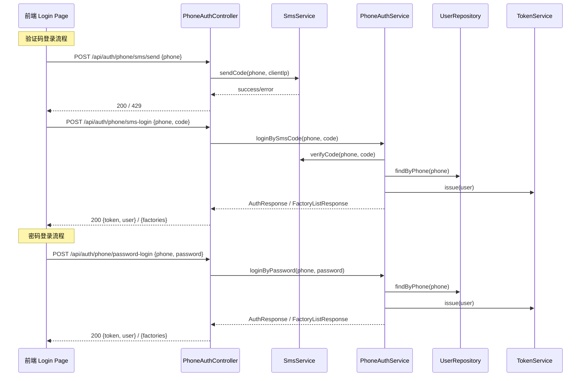

# 技术设计文档：手机号登录

## 概述

在现有工厂账号登录（工厂编号 + 用户名 + 密码）基础上，新增手机号登录方式。手机号登录支持两种子方式：
1. 手机号 + 密码登录
2. 手机号 + 短信验证码登录

系统通过 `FactoryUser.phone` 字段匹配用户。当同一手机号关联多个工厂时，需要用户选择目标工厂。登录成功后返回与现有登录相同格式的 `AuthResponse`（token + user）。

### 设计决策

- **复用现有 Token 机制**：使用 `TokenService` 签发 token，保持登录后行为一致
- **验证码存储使用 ConcurrentHashMap**：项目当前为单实例部署，无 Redis 依赖，使用内存存储验证码简单高效。未来如需多实例部署可替换为 Redis
- **频率限制使用内存计数器**：同上，单实例场景下内存方案足够
- **不新增数据库表**：`FactoryUser` 已有 `phone` 字段，无需 schema 变更

## 架构



## 组件与接口

### 后端新增组件

#### 1. PhoneAuthController

路径前缀：`/api/auth/phone`

| 端点 | 方法 | 请求体 | 响应 | 说明 |
|------|------|--------|------|------|
| `/password-login` | POST | `PhonePasswordLoginRequest` | `AuthResponse` 或 `PhoneLoginResponse` | 手机号+密码登录 |
| `/sms-login` | POST | `PhoneSmsLoginRequest` | `AuthResponse` 或 `PhoneLoginResponse` | 手机号+验证码登录 |
| `/sms/send` | POST | `SmsSendRequest` | `void` (200) | 发送验证码 |
| `/select-factory` | POST | `SelectFactoryRequest` | `AuthResponse` | 多工厂时选择工厂完成登录 |

#### 2. PhoneAuthService

核心业务逻辑服务：
- `loginByPassword(phone, password)` — 手机号+密码认证
- `loginBySmsCode(phone, code)` — 手机号+验证码认证
- `selectFactory(phone, factoryId, loginType, credential)` — 多工厂选择后完成登录

内部逻辑：
1. 通过 `UserRepository.findAllByPhone(phone)` 查询所有匹配用户
2. 若结果为空，返回错误
3. 若结果唯一，直接验证凭证并签发 token
4. 若结果多个，返回工厂列表供用户选择

#### 3. SmsService

短信验证码服务：
- `sendCode(phone, clientIp)` — 生成并"发送"验证码（当前阶段仅日志输出）
- `verifyCode(phone, code)` — 校验验证码是否正确且未过期

内部实现：
- 验证码存储：`ConcurrentHashMap<String, SmsCodeEntry>`
- `SmsCodeEntry`：包含 code（6位数字）、createdAt、verified 标记
- 有效期：5 分钟
- 频率限制：同一手机号 60 秒内不可重复发送

#### 4. RateLimiter（内嵌于 SmsService）

- 手机号维度：60 秒内最多 1 次
- IP 维度：1 小时内最多 10 次
- 使用 `ConcurrentHashMap` 存储计数，定期清理过期记录

### 后端 DTO

```java
// 手机号+密码登录请求
public class PhonePasswordLoginRequest {
    @NotBlank @Pattern(regexp = "^1\\d{10}$")
    private String phone;
    @NotBlank
    private String password;
}

// 手机号+验证码登录请求
public class PhoneSmsLoginRequest {
    @NotBlank @Pattern(regexp = "^1\\d{10}$")
    private String phone;
    @NotBlank @Pattern(regexp = "^\\d{6}$")
    private String code;
}

// 发送验证码请求
public class SmsSendRequest {
    @NotBlank @Pattern(regexp = "^1\\d{10}$")
    private String phone;
}

// 选择工厂请求
public class SelectFactoryRequest {
    @NotBlank @Pattern(regexp = "^1\\d{10}$")
    private String phone;
    @NotNull
    private Long factoryId;
    @NotBlank
    private String loginType; // "password" 或 "sms"
    private String credential; // 密码或验证码
}

// 手机号登录响应（多工厂场景）
public class PhoneLoginResponse {
    private boolean selectRequired; // true 表示需要选择工厂
    private String token;           // selectRequired=false 时有值
    private UserResponse user;      // selectRequired=false 时有值
    private List<FactoryOption> factories; // selectRequired=true 时有值
}

// 工厂选项
public class FactoryOption {
    private Long factoryId;
    private String factoryCode;
    private String factoryName;
}
```

### Repository 变更

在 `UserRepository` 中新增方法：

```java
List<FactoryUser> findAllByPhone(String phone);
```

### 前端组件变更

#### LoginPage 改造

当前登录表单直接嵌入 `App.vue`。改造方案：

1. 在登录区域顶部添加 Tab 切换组件（"手机号登录" | "工厂账号登录"）
2. 默认选中"手机号登录"Tab
3. 手机号登录 Tab 内部再提供"密码登录"/"验证码登录"子方式切换（文字链接样式）

#### 前端新增 API 函数

```typescript
// api.ts 新增
export interface PhonePasswordLoginPayload {
  phone: string
  password: string
}

export interface PhoneSmsLoginPayload {
  phone: string
  code: string
}

export interface SmsSendPayload {
  phone: string
}

export interface FactoryOption {
  factoryId: number
  factoryCode: string
  factoryName: string
}

export interface PhoneLoginResult {
  selectRequired: boolean
  token?: string
  user?: UserInfo
  factories?: FactoryOption[]
}

export interface SelectFactoryPayload {
  phone: string
  factoryId: number
  loginType: 'password' | 'sms'
  credential: string
}

export function phonePasswordLogin(payload: PhonePasswordLoginPayload) {
  return request<PhoneLoginResult>('/auth/phone/password-login', {
    method: 'POST',
    body: JSON.stringify(payload)
  })
}

export function phoneSmsLogin(payload: PhoneSmsLoginPayload) {
  return request<PhoneLoginResult>('/auth/phone/sms-login', {
    method: 'POST',
    body: JSON.stringify(payload)
  })
}

export function sendSmsCode(payload: SmsSendPayload) {
  return request<void>('/auth/phone/sms/send', {
    method: 'POST',
    body: JSON.stringify(payload)
  })
}

export function selectFactory(payload: SelectFactoryPayload) {
  return request<LoginResponse>('/auth/phone/select-factory', {
    method: 'POST',
    body: JSON.stringify(payload)
  })
}
```

## 数据模型

### 现有模型（无需变更）

`FactoryUser` 实体已包含 `phone` 字段（varchar(32)），且已有唯一约束 `uk_factory_phone(factory_id, phone)`。

同一手机号可以在不同工厂下存在（不同 factory_id），这正好支持"多工厂选择"场景。

### 内存数据结构（SmsService 内部）

```java
// 验证码条目
class SmsCodeEntry {
    String code;          // 6位数字验证码
    LocalDateTime createdAt;
    boolean verified;     // 是否已使用
}

// IP 频率限制条目
class IpRateEntry {
    int count;
    LocalDateTime windowStart;
}
```


## 正确性属性（Correctness Properties）

*属性是在系统所有有效执行中都应成立的特征或行为——本质上是关于系统应该做什么的形式化陈述。属性是人类可读规格说明与机器可验证正确性保证之间的桥梁。*

### Property 1: 有效凭证登录成功

*For any* 系统中存在的、已启用的用户，且该用户有手机号，当使用正确的手机号和正确的密码调用密码登录接口时，系统应返回一个非空的 token 和与该用户匹配的用户信息。

**Validates: Requirements 2.3**

### Property 2: 无效凭证统一拒绝（密码登录）

*For any* 手机号和密码组合，若手机号在系统中不存在，或密码与该手机号对应用户的密码不匹配，密码登录接口应返回 401 错误且错误信息为"手机号或密码不正确"。

**Validates: Requirements 2.4, 2.5**

### Property 3: 禁用账号拒绝登录

*For any* 已禁用的用户账号，无论提交的密码或验证码是否正确，登录接口应返回"账号已被禁用"的错误。

**Validates: Requirements 2.6**

### Property 4: 验证码生成格式

*For any* 有效的手机号（匹配 `^1\d{10}$`），调用发送验证码接口后，系统内部存储的验证码应为恰好 6 位数字字符串。

**Validates: Requirements 3.2**

### Property 5: 有效验证码登录成功

*For any* 系统中存在的、已启用的用户，当使用正确的手机号和在有效期内的正确验证码调用验证码登录接口时，系统应返回一个非空的 token 和与该用户匹配的用户信息。

**Validates: Requirements 3.5**

### Property 6: 无效验证码统一拒绝

*For any* 手机号和验证码组合，若验证码与系统发送的不匹配，或验证码已超过 5 分钟有效期，验证码登录接口应返回"验证码错误或已过期"的错误。

**Validates: Requirements 3.6, 3.7**

### Property 7: 未注册手机号拒绝（验证码登录）

*For any* 不存在于系统中的手机号，使用验证码登录时应返回"该手机号未注册"的错误。

**Validates: Requirements 3.8**

### Property 8: 手机号格式校验

*For any* 字符串，它通过手机号格式校验当且仅当它匹配正则表达式 `^1\d{10}$`。对于不匹配的字符串，后端接口应返回"手机号格式不正确"的错误。

**Validates: Requirements 4.1, 4.3**

### Property 9: 同一手机号 60 秒内发送频率限制

*For any* 手机号，若在 60 秒内已成功发送过一次验证码，再次请求发送应被拒绝并返回"发送过于频繁，请稍后再试"。

**Validates: Requirements 5.1**

### Property 10: 同一 IP 每小时发送次数限制

*For any* IP 地址，若在 1 小时内已发送超过 10 次验证码请求，后续请求应被拒绝并返回"请求过于频繁，请稍后再试"。

**Validates: Requirements 5.2**

### Property 11: 单用户匹配直接登录 vs 多用户匹配返回工厂列表

*For any* 手机号登录请求（凭证有效），若该手机号在系统中仅关联一个用户，应直接返回 token；若关联多个工厂的用户，应返回 `selectRequired=true` 和工厂列表，且列表长度等于关联的工厂数量。

**Validates: Requirements 6.1, 6.2**

### Property 12: 工厂选择后完成登录

*For any* 有效的工厂选择请求（手机号存在、工厂 ID 在该手机号关联的工厂列表中），系统应返回该工厂下对应用户的 token 和用户信息。

**Validates: Requirements 6.3**

### Property 13: 登录响应格式一致性

*For any* 成功的手机号登录（无论密码方式还是验证码方式），返回的响应应包含非空 token 和完整的 UserResponse（包含 id、username、name、role 等字段），与工厂账号登录的 AuthResponse 格式一致。

**Validates: Requirements 7.1**

## 错误处理

### 后端错误码映射

| 场景 | HTTP 状态码 | 错误信息 |
|------|------------|----------|
| 手机号格式不正确 | 400 | 手机号格式不正确 |
| 手机号或密码不正确 | 401 | 手机号或密码不正确 |
| 验证码错误或已过期 | 401 | 验证码错误或已过期 |
| 该手机号未注册 | 401 | 该手机号未注册 |
| 账号已被禁用 | 403 | 账号已被禁用 |
| 发送过于频繁（手机号维度） | 429 | 发送过于频繁，请稍后再试 |
| 请求过于频繁（IP 维度） | 429 | 请求过于频繁，请稍后再试 |

### 前端错误处理

- 手机号格式校验在前端拦截，不发送请求
- API 返回错误时，在表单下方显示红色错误提示文字
- 错误提示 5 秒后自动消失（复用现有 `errorMessage` 机制）
- 网络异常显示通用错误提示"网络异常，请稍后再试"

### 安全考虑

- 密码登录对"手机号不存在"和"密码错误"返回相同错误信息，防止手机号枚举
- 验证码登录对"验证码错误"和"验证码过期"返回相同错误信息
- 验证码使用后立即标记为已验证，防止重放
- IP 频率限制防止暴力攻击
- 验证码为 6 位随机数字，使用 `SecureRandom` 生成

## 测试策略

### 属性测试（Property-Based Testing）

使用 **jqwik**（Java 属性测试库）实现属性测试。

配置要求：
- 每个属性测试最少运行 100 次迭代
- 每个测试用注释标注对应的设计属性
- 标注格式：`Feature: phone-login, Property {number}: {property_text}`

属性测试覆盖范围：
- Property 2: 无效凭证拒绝 — 生成随机手机号和密码组合，验证不匹配时返回正确错误
- Property 4: 验证码格式 — 生成随机有效手机号，验证生成的验证码为 6 位数字
- Property 6: 无效验证码拒绝 — 生成随机错误验证码，验证返回正确错误
- Property 8: 手机号格式校验 — 生成随机字符串，验证校验结果与正则匹配一致
- Property 9: 频率限制 — 对同一手机号连续发送，验证第二次被拒绝
- Property 11: 单/多用户路由 — 生成不同数量的用户关联，验证返回行为正确

### 单元测试

使用 **JUnit 5 + Mockito** 实现单元测试。

覆盖范围：
- PhoneAuthService 各登录路径的具体示例
- SmsService 验证码生成、校验、过期的具体示例
- 频率限制边界条件（恰好 60 秒、恰好第 10 次）
- 多工厂选择流程的集成测试
- 前端手机号格式校验的边界值（10位、12位、非1开头等）

### 前端测试

- Tab 切换显示正确表单
- 倒计时逻辑正确性
- 手机号格式校验拦截无效输入
- 登录成功后 token 存储和页面跳转
