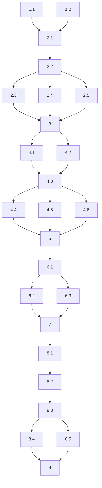

# Implementation Plan: 手机号登录

## Overview

基于增量交付原则，从底层数据访问层开始，逐步向上构建 Service、Controller，最后实现前端 UI。每一步都在前一步基础上构建，确保无孤立代码。

## Tasks

- [x] 1. 后端 Repository 和 DTO 层
  - [x] 1.1 在 UserRepository 中新增 `findAllByPhone(String phone)` 方法
    - 返回 `List<FactoryUser>`，用于查询所有匹配该手机号的用户
    - _Requirements: 6.1, 6.2_

  - [x] 1.2 创建手机号登录相关 DTO 类
    - 创建 `PhonePasswordLoginRequest`（phone + password，含 `@Pattern` 校验）
    - 创建 `PhoneSmsLoginRequest`（phone + code，含格式校验）
    - 创建 `SmsSendRequest`（phone，含格式校验）
    - 创建 `SelectFactoryRequest`（phone + factoryId + loginType + credential）
    - 创建 `FactoryOption`（factoryId + factoryCode + factoryName）
    - 创建 `PhoneLoginResponse`（selectRequired + token + user + factories）
    - _Requirements: 2.2, 3.1, 4.1, 6.2_

- [x] 2. 后端 SmsService 实现
  - [x] 2.1 创建 SmsService 类，实现验证码生成、存储和校验
    - 使用 `ConcurrentHashMap<String, SmsCodeEntry>` 存储验证码
    - `sendCode(phone, clientIp)` — 生成 6 位随机数字验证码（SecureRandom），日志输出
    - `verifyCode(phone, code)` — 校验验证码正确性和 5 分钟有效期，使用后标记 verified
    - _Requirements: 3.2, 3.5, 3.6, 3.7_

  - [x] 2.2 在 SmsService 中实现频率限制逻辑
    - 手机号维度：60 秒内同一手机号最多发送 1 次
    - IP 维度：1 小时内同一 IP 最多发送 10 次
    - 使用 `ConcurrentHashMap` 存储计数，定期清理过期记录
    - _Requirements: 5.1, 5.2_

  - [x] 2.3 编写 SmsService 单元测试
    - 测试验证码生成为 6 位数字
    - 测试正确验证码校验通过
    - 测试错误验证码校验失败
    - 测试过期验证码校验失败（模拟时间）
    - 测试手机号 60 秒频率限制
    - 测试 IP 每小时 10 次限制
    - _Requirements: 3.2, 3.6, 3.7, 5.1, 5.2_

  - [x] 2.4 编写 SmsService 属性测试（jqwik）
    - **Property 4: 验证码生成格式** — 对任意有效手机号，生成的验证码为恰好 6 位数字
    - **Validates: Requirements 3.2**

  - [x] 2.5 编写频率限制属性测试（jqwik）
    - **Property 9: 同一手机号 60 秒内发送频率限制** — 对同一手机号连续发送两次，第二次应被拒绝
    - **Validates: Requirements 5.1**

- [x] 3. Checkpoint - 确保 SmsService 所有测试通过
  - Ensure all tests pass, ask the user if questions arise.

- [x] 4. 后端 PhoneAuthService 实现
  - [x] 4.1 创建 PhoneAuthService 类，实现手机号+密码登录逻辑
    - 调用 `UserRepository.findAllByPhone(phone)` 查询用户
    - 手机号不存在返回 401 "手机号或密码不正确"
    - 密码不匹配返回 401 "手机号或密码不正确"
    - 账号禁用返回 403 "账号已被禁用"
    - 单用户直接签发 token，多用户返回工厂列表
    - _Requirements: 2.3, 2.4, 2.5, 2.6, 6.1, 6.2_

  - [x] 4.2 在 PhoneAuthService 中实现手机号+验证码登录逻辑
    - 调用 `SmsService.verifyCode` 校验验证码
    - 验证码错误或过期返回 401 "验证码错误或已过期"
    - 手机号不存在返回 401 "该手机号未注册"
    - 账号禁用返回 403 "账号已被禁用"
    - 单用户直接签发 token，多用户返回工厂列表
    - _Requirements: 3.5, 3.6, 3.7, 3.8, 6.1, 6.2_

  - [x] 4.3 在 PhoneAuthService 中实现工厂选择登录逻辑
    - `selectFactory(phone, factoryId, loginType, credential)` — 验证凭证后签发指定工厂用户的 token
    - _Requirements: 6.3, 7.1_

  - [x] 4.4 编写 PhoneAuthService 单元测试（JUnit 5 + Mockito）
    - 测试密码登录成功（单用户）
    - 测试密码登录失败（手机号不存在、密码错误、账号禁用）
    - 测试验证码登录成功（单用户）
    - 测试验证码登录失败（验证码错误、过期、手机号未注册）
    - 测试多工厂场景返回工厂列表
    - 测试工厂选择后完成登录
    - _Requirements: 2.3, 2.4, 2.5, 2.6, 3.5, 3.6, 3.7, 3.8, 6.1, 6.2, 6.3_

  - [x] 4.5 编写 PhoneAuthService 属性测试（jqwik）
    - **Property 2: 无效凭证统一拒绝（密码登录）** — 对任意不存在的手机号或不匹配的密码，返回 401 "手机号或密码不正确"
    - **Validates: Requirements 2.4, 2.5**

  - [x] 4.6 编写多工厂路由属性测试（jqwik）
    - **Property 11: 单用户匹配直接登录 vs 多用户匹配返回工厂列表** — 对不同数量的用户关联，验证返回行为正确
    - **Validates: Requirements 6.1, 6.2**

- [x] 5. Checkpoint - 确保 PhoneAuthService 所有测试通过
  - Ensure all tests pass, ask the user if questions arise.

- [x] 6. 后端 PhoneAuthController 实现
  - [x] 6.1 创建 PhoneAuthController，暴露手机号登录 REST 接口
    - `POST /api/auth/phone/password-login` — 手机号+密码登录
    - `POST /api/auth/phone/sms-login` — 手机号+验证码登录
    - `POST /api/auth/phone/sms/send` — 发送验证码（从 HttpServletRequest 获取客户端 IP）
    - `POST /api/auth/phone/select-factory` — 多工厂选择登录
    - 使用 `@Valid` 触发 DTO 校验，格式不合法时返回 400
    - _Requirements: 2.3, 3.5, 4.3, 6.3_

  - [x] 6.2 在 SecurityBeans 或安全配置中放行 `/api/auth/phone/**` 路径
    - 确保手机号登录相关接口无需认证即可访问
    - _Requirements: 2.3, 3.5_

  - [x] 6.3 编写手机号格式校验属性测试（jqwik）
    - **Property 8: 手机号格式校验** — 对任意字符串，通过校验当且仅当匹配 `^1\d{10}$`
    - **Validates: Requirements 4.1, 4.3**

- [x] 7. Checkpoint - 确保后端所有测试通过，接口可正常调用
  - Ensure all tests pass, ask the user if questions arise.

- [x] 8. 前端 API 层和手机号登录 UI
  - [x] 8.1 在 `frontend/src/api.ts` 中新增手机号登录相关 API 函数
    - `phonePasswordLogin(payload)` — 手机号+密码登录
    - `phoneSmsLogin(payload)` — 手机号+验证码登录
    - `sendSmsCode(payload)` — 发送验证码
    - `selectFactory(payload)` — 选择工厂完成登录
    - 定义 `PhoneLoginResult`、`FactoryOption`、`SelectFactoryPayload` 等接口
    - _Requirements: 2.3, 3.5, 6.3_

  - [x] 8.2 改造登录页面，添加 Tab 切换组件
    - 在登录区域顶部添加"手机号登录"和"工厂账号登录"两个 Tab
    - 默认选中"手机号登录"Tab
    - Tab 切换时显示/隐藏对应表单
    - _Requirements: 1.1, 1.2, 1.3, 1.4_

  - [x] 8.3 实现手机号登录表单（密码登录 + 验证码登录子方式切换）
    - 提供"密码登录"/"验证码登录"子方式切换（文字链接样式）
    - 密码登录：手机号输入框 + 密码输入框
    - 验证码登录：手机号输入框 + 验证码输入框 + "获取验证码"按钮
    - 前端手机号格式校验（`^1\d{10}$`），不合法时显示"请输入正确的手机号"
    - _Requirements: 2.1, 2.2, 3.1, 4.1, 4.2_

  - [x] 8.4 实现验证码发送倒计时逻辑
    - 点击"获取验证码"后显示 60 秒倒计时
    - 倒计时期间按钮不可点击
    - 倒计时结束恢复按钮可点击状态
    - _Requirements: 3.3, 3.4_

  - [x] 8.5 实现多工厂选择流程和登录成功处理
    - 当 API 返回 `selectRequired=true` 时，显示工厂列表供用户选择
    - 用户选择工厂后调用 `selectFactory` 接口完成登录
    - 登录成功后存储 token 到本地并跳转到主页面（复用现有逻辑）
    - 错误提示显示在表单下方，5 秒后自动消失
    - _Requirements: 6.2, 6.3, 7.1, 7.2_

- [x] 9. Final Checkpoint - 确保前后端联调完成，所有测试通过
  - Ensure all tests pass, ask the user if questions arise.

## Task Dependency Graph

## Notes

- 每个任务引用了具体的需求编号，确保可追溯性
- 属性测试使用 jqwik 库，单元测试使用 JUnit 5 + Mockito
- 后端验证码当前阶段仅日志输出，不实际发送短信
- Checkpoint 确保增量验证，及早发现问题
