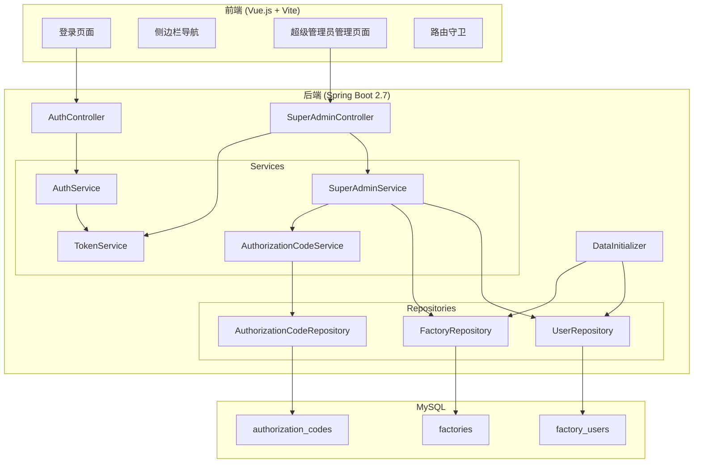
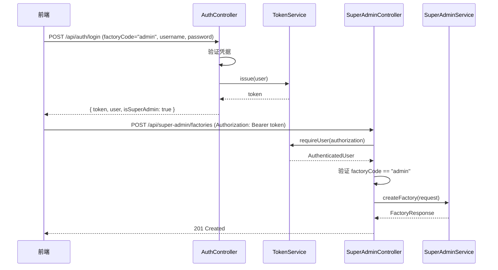

# Design Document: Super Admin Management (超级管理员管理)

## Overview

本设计文档描述超级管理员账户体系及其综合管理平台的完整技术方案。系统将从现有的 API Key (`X-Super-Admin-Key`) 认证方式迁移到基于 Bearer Token 的用户账户认证，并扩展超级管理员的管理能力，包括工厂代码创建、工厂管理员账号生成、授权码管理、资源停用/启用，以及创建其他超级管理员账号。

### 设计决策

1. **复用现有 Factory/FactoryUser 模型**：超级管理员使用工厂代码 "admin" 的 Factory 作为容器，无需引入新的用户模型
2. **Bearer Token 统一认证**：所有超级管理员 API 使用与普通用户相同的 TokenService 进行认证，通过检查用户所属工厂代码是否为 "admin" 来判断超级管理员身份
3. **Factory 模型扩展 enabled 字段**：在现有 Factory 实体上增加 `enabled` 字段以支持停用功能
4. **AuthorizationCode 模型扩展 disabled 字段**：增加 `disabled` 字段以区分"被管理员主动停用"和"已过期/已消费"状态
5. **前端条件渲染**：通过登录响应中的 `isSuperAdmin` 标志控制侧边栏菜单可见性和路由守卫

## Architecture

### 系统架构图



### 认证流程



## Components and Interfaces

### 后端组件

#### 1. SuperAdminController (新建)

替代现有的 `AuthorizationCodeController`，统一处理所有超级管理员 API。

```java
@RestController
@RequestMapping("/api/super-admin")
public class SuperAdminController {

    // 工厂管理
    POST   /factories                    → createFactory(CreateFactoryRequest)
    GET    /factories                    → listFactories()
    PATCH  /factories/{code}/disable     → disableFactory(code)
    PATCH  /factories/{code}/enable      → enableFactory(code)

    // 工厂管理员账号
    POST   /factory-admins               → createFactoryAdmin(CreateFactoryAdminRequest)
    GET    /factory-admins               → listFactoryAdmins()
    PATCH  /factory-admins/{id}/disable  → disableFactoryAdmin(id)
    PATCH  /factory-admins/{id}/enable   → enableFactoryAdmin(id)

    // 授权码
    POST   /auth-codes                   → generateAuthCode(GenerateAuthCodeRequest)
    GET    /auth-codes                   → listAuthCodes()
    PATCH  /auth-codes/{id}/disable      → disableAuthCode(id)

    // 超级管理员账号
    POST   /admins                       → createSuperAdmin(CreateSuperAdminRequest)
}
```

#### 2. SuperAdminService (新建)

核心业务逻辑服务，处理工厂创建、管理员账号生成、资源停用/启用。

```java
@Service
public class SuperAdminService {
    FactoryResponse createFactory(String code, String name);
    FactoryAdminResponse createFactoryAdmin(String factoryCode, String username, String password);
    void createSuperAdmin(String username, String password);
    ManagementListResponse getManagementList();
    void disableFactory(String factoryCode);
    void enableFactory(String factoryCode);
    void disableFactoryAdmin(Long userId);
    void enableFactoryAdmin(Long userId);
    void disableAuthCode(Long authCodeId);
}
```

#### 3. TokenService 扩展

新增 `requireSuperAdmin` 方法，验证 Bearer Token 并确认用户属于 admin 工厂。

```java
public AuthenticatedUser requireSuperAdmin(String authorization) {
    AuthenticatedUser user = requireUser(authorization);
    // 通过 factoryId 查询 factory code 是否为 "admin"
    // 或在 AuthenticatedUser 中增加 factoryCode 字段
    if (!isSuperAdminFactory(user.getFactoryId())) {
        throw new ApiException(HttpStatus.FORBIDDEN, "需要超级管理员权限");
    }
    return user;
}
```

#### 4. AuthService 修改

在登录响应中增加 `isSuperAdmin` 标志，并在登录时检查工厂是否被停用。

#### 5. DataInitializer 修改

保持现有逻辑不变，已满足需求 1 的种子数据初始化要求。现有实现已经：
- 创建 admin 工厂（如不存在）
- 创建 admin 用户（如不存在）
- 恢复 admin 用户的 role 和 enabled 状态

### 前端组件

#### 1. SuperAdminAuthCodesPage 重构

将现有的 `SuperAdminAuthCodesPage.vue` 组件重构为综合管理页面，包含三个 Tab：
- **工厂管理**：显示工厂列表，支持创建工厂、停用/启用
- **管理员账号**：显示工厂管理员列表，支持生成账号、停用/启用
- **授权码管理**：显示授权码列表，支持生成授权码、停用

#### 2. App.vue 修改

- 登录响应处理：存储 `isSuperAdmin` 标志
- 侧边栏渲染：根据 `isSuperAdmin` 条件显示/隐藏"授权码管理"菜单项
- 路由守卫：非超级管理员访问管理页面时重定向到默认页面

### API 接口定义

#### Request DTOs

```java
public class CreateFactoryRequest {
    @NotBlank String factoryCode;  // 1-16 uppercase alphanumeric
    @NotBlank String factoryName;  // 1-128 characters
}

public class CreateFactoryAdminRequest {
    @NotBlank String factoryCode;
    @NotBlank String username;     // 1-64 characters
    String password;               // optional, >= 6 chars if provided
}

public class CreateSuperAdminRequest {
    @NotBlank String username;     // 3-32 alphanumeric
    @NotBlank String password;     // 6-64 characters
}

public class GenerateAuthCodeRequest {
    @NotBlank String factoryCode;
    Integer expirationMinutes;     // 1-1440, default 30
}
```

#### Response DTOs

```java
public class FactoryResponse {
    String factoryCode;
    String factoryName;
    boolean enabled;
    LocalDateTime createdAt;
}

public class FactoryAdminResponse {
    String factoryCode;
    String username;
    String password;  // 明文返回（仅创建时）
    boolean enabled;
    LocalDateTime createdAt;
}

public class ManagementListResponse {
    List<FactoryListItem> factories;
    List<FactoryAdminListItem> factoryAdmins;
    List<AuthCodeListItem> authCodes;
}

public class AuthCodeListItem {
    Long id;
    String code;
    String factoryCode;
    String status;  // "active" | "expired" | "consumed" | "disabled"
    LocalDateTime createdAt;
    LocalDateTime expiresAt;
}
```

## Data Models

### Factory 实体扩展

```java
@Entity
@Table(name = "factories")
public class Factory {
    @Id @GeneratedValue(strategy = GenerationType.IDENTITY)
    private Long id;
    
    @Column(nullable = false, unique = true, length = 64)
    private String code;
    
    @Column(nullable = false, length = 128)
    private String name;
    
    @Column(nullable = false)
    private boolean enabled = true;  // 新增字段
    
    @Column(nullable = false)
    private LocalDateTime createdAt;
}
```

**数据库迁移**：
```sql
ALTER TABLE factories ADD COLUMN enabled BOOLEAN NOT NULL DEFAULT TRUE;
```

### AuthorizationCode 实体扩展

```java
@Entity
@Table(name = "authorization_codes")
public class AuthorizationCode {
    // ... 现有字段 ...
    
    @Column(nullable = false)
    private boolean disabled = false;  // 新增字段
    
    @Column
    private LocalDateTime disabledAt;  // 新增字段
}
```

**数据库迁移**：
```sql
ALTER TABLE authorization_codes ADD COLUMN disabled BOOLEAN NOT NULL DEFAULT FALSE;
ALTER TABLE authorization_codes ADD COLUMN disabled_at DATETIME NULL;
```

### AuthenticatedUser 扩展

```java
public class AuthenticatedUser {
    private final Long userId;
    private final Long factoryId;
    private final String factoryCode;  // 新增字段
    private final Role role;
    private final String name;
}
```

### AuthResponse 扩展

```java
public class AuthResponse {
    private String token;
    private UserResponse user;
    private boolean isSuperAdmin;  // 新增字段
}
```

### 授权码状态计算逻辑

状态优先级（从高到低）：
1. `disabled` = true → 状态为 "disabled"
2. `consumed` = true → 状态为 "consumed"
3. `expiresAt` <= 当前时间 → 状态为 "expired"
4. 其他 → 状态为 "active"

```java
public String calculateStatus(AuthorizationCode code) {
    if (code.isDisabled()) return "disabled";
    if (code.isConsumed()) return "consumed";
    if (!code.getExpiresAt().isAfter(LocalDateTime.now())) return "expired";
    return "active";
}
```

### 工厂代码验证规则

```java
// 正则: ^[A-Z0-9]{1,16}$
private static final Pattern FACTORY_CODE_PATTERN = Pattern.compile("^[A-Z0-9]{1,16}$");

// 保留代码（不区分大小写）
private boolean isReservedCode(String code) {
    return "ADMIN".equalsIgnoreCase(code);
}
```

### 随机密码生成

```java
private static final String PASSWORD_CHARS = "ABCDEFGHIJKLMNOPQRSTUVWXYZabcdefghijklmnopqrstuvwxyz0123456789";
private static final int GENERATED_PASSWORD_LENGTH = 6;

public String generateRandomPassword() {
    SecureRandom random = new SecureRandom();
    StringBuilder sb = new StringBuilder(GENERATED_PASSWORD_LENGTH);
    for (int i = 0; i < GENERATED_PASSWORD_LENGTH; i++) {
        sb.append(PASSWORD_CHARS.charAt(random.nextInt(PASSWORD_CHARS.length())));
    }
    return sb.toString();
}
```

## Correctness Properties

*A property is a characteristic or behavior that should hold true across all valid executions of a system—essentially, a formal statement about what the system should do. Properties serve as the bridge between human-readable specifications and machine-verifiable correctness guarantees.*

### Property 1: Reserved factory code protection

*For any* factory creation request where the factory code equals "ADMIN" (case-insensitive comparison), the SuperAdminService SHALL reject the request with an error, regardless of the factory name or other parameters provided.

**Validates: Requirements 1.5, 3.4**

### Property 2: Non-admin factory login does not grant super admin flag

*For any* user login where the factory code is not "admin", the login response SHALL have `isSuperAdmin` set to false.

**Validates: Requirements 2.2**

### Property 3: Super admin endpoint authentication guard

*For any* request to a `/api/super-admin/` endpoint where the Bearer token is missing, invalid, or belongs to a user whose factory code is not "admin", the system SHALL reject the request with an authentication/authorization error.

**Validates: Requirements 2.5, 9.1, 9.2, 9.3**

### Property 4: Valid factory creation succeeds

*For any* factory code matching `[A-Z0-9]{1,16}` that is not "ADMIN" (case-insensitive) and does not already exist in the system, and *for any* factory name of 1-128 characters that does not already exist, the SuperAdminService SHALL successfully create the factory and return the code and name.

**Validates: Requirements 3.1**

### Property 5: Factory uniqueness constraints

*For any* factory code that already exists in the system, a second factory creation request with the same code SHALL be rejected. Similarly, *for any* factory name that already exists, a creation request with the same name SHALL be rejected.

**Validates: Requirements 3.3, 3.5**

### Property 6: Invalid factory code format rejection

*For any* string that does not match the pattern `[A-Z0-9]{1,16}` (contains lowercase letters, special characters, or exceeds 16 characters), a factory creation request with that code SHALL be rejected with a format error.

**Validates: Requirements 3.7**

### Property 7: Generated password format compliance

*For any* factory admin creation request where no password is provided, the generated password SHALL be exactly 6 characters long and match the pattern `[A-Za-z0-9]{6}`.

**Validates: Requirements 4.5**

### Property 8: Factory admin username uniqueness within factory

*For any* factory and *for any* username that already exists in that factory, a second factory admin creation request with the same username and factory code SHALL be rejected.

**Validates: Requirements 4.3**

### Property 9: Authorization code format and storage

*For any* valid factory code and expiration minutes in [1, 1440], the generated authorization code SHALL be exactly 8 characters matching `[A-Z0-9]{8}`, and SHALL be stored with an expiration timestamp equal to creation time plus the specified minutes.

**Validates: Requirements 5.1**

### Property 10: Authorization code generation non-interference

*For any* factory with N existing active (non-consumed, non-expired, non-disabled) authorization codes, generating a new code SHALL result in N+1 active codes, with all previously active codes retaining their original status.

**Validates: Requirements 5.5**

### Property 11: Authorization code status calculation priority

*For any* authorization code, the calculated status SHALL follow this priority: if `disabled` is true, status is "disabled"; else if `consumed` is true, status is "consumed"; else if current time >= `expiresAt`, status is "expired"; else status is "active".

**Validates: Requirements 6.4, 6.5, 6.6, 6.7**

### Property 12: Management list excludes admin factory and sorts descending

*For any* set of factories in the system, the factory list returned by the management endpoint SHALL exclude the factory with code "admin" and SHALL be sorted by `createdAt` in descending order.

**Validates: Requirements 6.1**

### Property 13: Cascading factory disable

*For any* factory (not the admin factory) with N users and M active authorization codes, disabling the factory SHALL result in: factory.enabled=false, all N users having enabled=false, and all M active codes having disabled=true.

**Validates: Requirements 7.1**

### Property 14: Disabled factory blocks login

*For any* factory where enabled=false and *for any* user in that factory with valid credentials, a login attempt SHALL be rejected with a factory disabled error.

**Validates: Requirements 7.7**

### Property 15: Factory enable does not cascade to child resources

*For any* disabled factory with disabled users and disabled authorization codes, enabling the factory SHALL only set factory.enabled=true without modifying the enabled/disabled state of any users or authorization codes.

**Validates: Requirements 7.8**

### Property 16: Disable operation idempotence

*For any* resource (factory, user, or authorization code) that is already disabled, a subsequent disable request SHALL return success without modifying the resource's state or timestamps.

**Validates: Requirements 7.9**

### Property 17: Super admin creation with valid inputs

*For any* username matching `[A-Za-z0-9]{3,32}` that does not already exist in the admin factory, and *for any* password of 6-64 characters, the SuperAdminService SHALL create a FactoryUser in the admin factory with role ADMIN, enabled=true, and virtualUser=false.

**Validates: Requirements 8.1**

### Property 18: Super admin input validation

*For any* username that does not match `[A-Za-z0-9]{3,32}` (too short, too long, or contains non-alphanumeric characters), OR *for any* password shorter than 6 or longer than 64 characters, the super admin creation request SHALL be rejected with a validation error.

**Validates: Requirements 8.5, 8.7**

## Error Handling

### 错误响应格式

所有错误使用统一的 `ErrorResponse` 格式：

```java
public class ErrorResponse {
    private String message;
    private int status;
    private LocalDateTime timestamp;
}
```

### 错误场景分类

| 场景 | HTTP Status | 错误消息 |
|------|-------------|----------|
| 未认证（无 Token / Token 无效） | 401 | "请先登录" |
| 非超级管理员访问 | 403 | "需要超级管理员权限" |
| 工厂代码已存在 | 400 | "工厂代码已存在" |
| 工厂名称已存在 | 400 | "工厂名称已被使用" |
| 工厂代码格式无效 | 400 | "工厂代码格式无效，需为1-16位大写字母和数字" |
| 保留工厂代码 | 400 | "该工厂代码为系统保留代码" |
| 工厂代码不存在 | 400 | "工厂代码无效" |
| 工厂已停用 | 400 | "该工厂已被停用" |
| 用户名已存在 | 400 | "用户名已存在" |
| 用户名格式无效 | 400 | "用户名格式无效" |
| 密码过短 | 400 | "密码长度不能少于6位" |
| 资源不存在 | 404 | "资源不存在" |
| 禁止停用超级管理员工厂 | 403 | "超级管理员工厂不能被停用" |
| 工厂已停用（登录时） | 401 | "该工厂已被停用，无法登录" |
| 有效期超出范围 | 400 | "有效期必须在1-1440分钟之间" |
| 必填字段缺失 | 400 | "必填字段不能为空" |

### 事务处理

- 工厂停用操作（级联停用用户和授权码）使用 `@Transactional` 确保原子性
- 授权码生成使用乐观锁（`@Version`）防止并发冲突
- 工厂创建使用数据库唯一约束作为最终防线

## Testing Strategy

### 测试框架

- **后端单元测试**：JUnit 5 + Mockito
- **后端属性测试**：jqwik 1.7.4（已在 pom.xml 中配置）
- **前端单元测试**：Vitest + @vue/test-utils
- **前端属性测试**：fast-check（已在 node_modules 中）

### 属性测试配置

- 每个属性测试最少运行 100 次迭代
- 使用 jqwik 的 `@Property` 注解配置 `tries = 100`
- 每个测试标注对应的设计文档属性编号

**标签格式**：`Feature: super-admin-management, Property {number}: {property_text}`

### 测试分层

#### 属性测试（Property-Based Tests）

覆盖 Correctness Properties 中定义的 18 个属性，重点测试：
- 输入验证逻辑（工厂代码格式、用户名格式、密码长度）
- 状态计算逻辑（授权码状态优先级）
- 业务规则（保留代码保护、唯一性约束、级联操作）
- 幂等性（重复停用操作）

#### 单元测试（Example-Based Tests）

- 种子数据初始化的各种场景
- 登录响应中 `isSuperAdmin` 标志的正确设置
- 默认有效期（30分钟）的应用
- 前端路由守卫的重定向行为
- `X-Super-Admin-Key` 认证方式的废弃验证

#### 集成测试

- 完整的超级管理员登录流程
- 新创建的超级管理员登录验证
- 工厂停用后登录被拒绝的端到端验证

### 后端测试示例结构

```java
// 属性测试
@Property(tries = 100)
// Feature: super-admin-management, Property 6: Invalid factory code format rejection
void invalidFactoryCodeIsRejected(@ForAll @StringLength(min = 1, max = 20) String code) {
    Assume.that(!code.matches("[A-Z0-9]{1,16}"));
    // 验证 service 抛出 ApiException
}

// 单元测试
@Test
void loginWithAdminFactoryReturnsIsSuperAdminTrue() {
    // 具体场景验证
}
```

### 前端测试示例结构

```typescript
// 属性测试 (fast-check)
import fc from 'fast-check'

// Feature: super-admin-management, Property 2: Non-admin factory login
test('non-admin factory code results in isSuperAdmin=false', () => {
  fc.assert(fc.property(
    fc.string().filter(s => s.toLowerCase() !== 'admin' && s.length > 0),
    (factoryCode) => {
      // 验证 isSuperAdmin 计算逻辑
      expect(isSuperAdmin(factoryCode)).toBe(false)
    }
  ), { numRuns: 100 })
})
```
