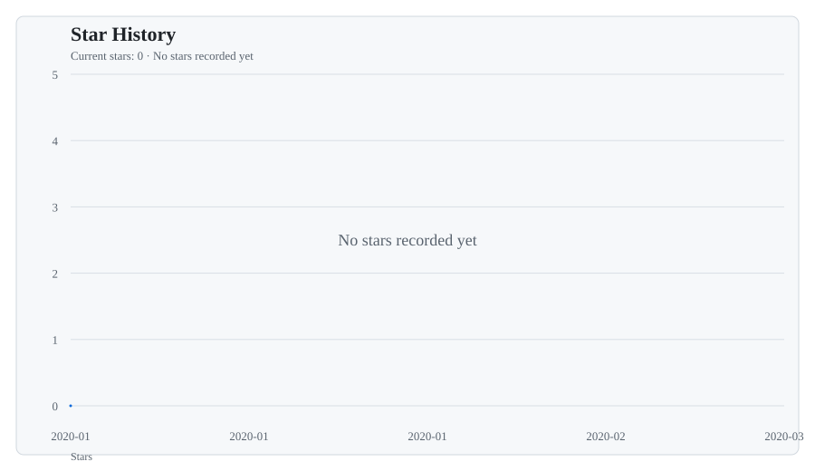

# 黑湖小工单

一个面向生产协同场景的工单、报工、库存和基础数据管理系统。项目由 Spring Boot 后端、Vue 3 管理端、uni-app 移动端和可独立部署的插件服务组成，当前用于持续开发、内部验证和部署能力建设。

[](https://github.com/Z7Y-CCCCC/gongdan/actions/workflows/ci.yml)
[](https://github.com/Z7Y-CCCCC/gongdan/actions/workflows/star-history.yml)

## Star History

Star History 图表现在由仓库自己的 GitHub Actions 生成并保存到 `docs/`，不再依赖容易失效的第三方实时 SVG 接口。工作流每天定时运行，也可以在 GitHub Actions 页面手动执行 `Update Star History`。

<a href="https://www.star-history.com/#Z7Y-CCCCC/gongdan&Date">
  <picture>
    <source media="(prefers-color-scheme: dark)" srcset="docs/star-history-dark.svg">
    
  </picture>
</a>

没有显示图表时，先手动运行 [Update Star History](https://github.com/Z7Y-CCCCC/gongdan/actions/workflows/star-history.yml)；交互式查看仍可打开 [Star History](https://www.star-history.com/#Z7Y-CCCCC/gongdan&Date)。

## 功能范围

| 模块 | 能力 |
| --- | --- |
| 工单与生产 | 工单、工序任务、报工、进度、工单报表和导出 |
| 库存与单据 | 入库单、出库单、库存明细、库存结余、物料清单 |
| 基础数据 | 产品、客户、供应商、仓库、单位、工序、工艺路线和分类 |
| 系统配置 | 用户、部门、工厂、权限、通知、内部聊天和字段配置 |
| 外部数据源 | 工厂级 HTTP API / SQLite 配置、手动健康检查与只读元数据浏览；网络数据库待真实验收，暂不开放（不含业务同步） |
| 移动端 | uni-app H5 和微信小程序的工单、报工、报表和现场记录 |
| 插件平台 | 工厂级安装、启停、配置、健康检查、灰度、回滚和卸载 |
| MCP 诊断 | 面向 AI Agent 的只读健康检查、接口检查、冒烟测试和日志查询 |
| 运维能力 | Compose 部署、备份校验、远端备份、恢复演练和运行监控 |

## 技术栈

- 后端：Java 8、Spring Boot 2.7、Spring Data JPA、Spring Security Crypto、Flyway、MySQL、Redis。
- 管理端：Vue 3、Vite、TypeScript、Vitest、ExcelJS。
- 移动端：uni-app、Vue 3、TypeScript，支持 H5 和微信小程序。
- 插件：独立 Spring Boot 服务，通过核心网关和 HMAC 签名通信。
- 诊断网关：Node.js 22、官方 MCP TypeScript SDK、Streamable HTTP。

## 目录结构

```text
backend/                         Spring Boot 核心服务
frontend/                        Vue 3 管理端
mobile/                          uni-app 移动端
plugins/quality-management/      质量管理演示插件
plugins/equipment-inspection/    设备点检验收插件
ops/mcp/                         只读 MCP 诊断网关
ops/                             Compose 运维、备份、恢复和压测脚本
deploy/windows/                  Windows Server 部署脚本
docs/                            插件、验收、备份和灾备文档
```

## 本地启动

### 环境要求

- Java 8 和 Maven 3.8+
- Node.js 22 LTS（22.12+）或 24 LTS；CI 与前端/移动端构建镜像使用 Node.js 22。
- MySQL 8.4+，本地示例默认使用 `3308` 端口
- Redis 7+，本地示例默认使用 `6379` 端口

### 启动后端

```powershell
cd backend
mvn spring-boot:run
```

默认 API 地址为 `http://localhost:8080/api`。本地连接参数可通过 `SPRING_DATASOURCE_*`、`SPRING_REDIS_*` 环境变量覆盖。不要把本地示例密码用于生产环境。

### 启动管理端

```powershell
cd frontend
npm ci
npm run dev
```

打开 `http://localhost:5173`。前端 API 默认访问 `http://localhost:8080/api`，可在 `frontend/.env` 中设置 `VITE_API_BASE_URL`。

开发和预览服务默认只监听本机。确需局域网联调时，可显式使用 `npm run dev -- --host 0.0.0.0`，并限制在可信网络；不要把开发服务器作为公网生产服务。

### 启动移动端

```powershell
cd mobile
npm ci
npm run dev:h5
```

生产构建使用 `npm run build`；微信小程序使用 `npm run build:mp-weixin`。移动端配置见 `mobile/.env.example`。

## Docker Compose

复制部署模板并替换全部示例值：

```bash
cp .env.deploy.example .env
docker compose up --build -d
```

默认启动 MySQL、Redis、后端和管理端。插件和 MCP 都是可选 profile：

```bash
docker compose --profile plugins up --build -d
docker compose --profile mcp up --build -d mcp
```

完整的生产环境变量、Windows Server 部署和反向代理说明见 [`DEPLOYMENT.md`](DEPLOYMENT.md) 与 [`deploy/windows/README.md`](deploy/windows/README.md)。

## 插件平台

插件中心位于“系统配置 > 插件中心”。核心服务只保存目录、版本、工厂绑定和配置，不把第三方代码加载进核心 JVM。插件服务独立运行，核心网关负责工厂、角色、版本、健康状态、超时、熔断和 HMAC 校验。

- 质量管理演示插件：[`plugins/quality-management`](plugins/quality-management)
- 设备点检验收插件：[`plugins/equipment-inspection`](plugins/equipment-inspection)
- 平台边界和当前限制：[`docs/PLUGIN_PLATFORM.md`](docs/PLUGIN_PLATFORM.md)
- 验收结果：[`docs/PLUGIN_ACCEPTANCE_REPORT.md`](docs/PLUGIN_ACCEPTANCE_REPORT.md)

当前插件平台是受控的独立服务底座，不是可以从互联网下载并自动执行任意代码的插件商店。制品签名、漏洞扫描、自动部署和插件独立持久化仍需要在上线前继续建设。

## 高级报表

系统保留内置生产报表，并提供直接嵌入 Spring Boot 的 UReport2 高级报表入口，不依赖 Docker 或独立报表服务。配置、权限和工厂隔离验收步骤见 [`docs/REPORTING_INTEGRATION.md`](docs/REPORTING_INTEGRATION.md)。

## 外部数据源

外部数据源一期当前开放 HTTP API 和 SQLite；MySQL、PostgreSQL、SQL Server 的适配代码和驱动保留，但未完成真实服务/TLS 验收，前后端均暂不开放。配置、出口授权、凭据密钥、V22 升级和验收边界见 [`docs/EXTERNAL_DATA_SOURCES.md`](docs/EXTERNAL_DATA_SOURCES.md)。默认拒绝未授权外部连接，不改变核心数据库和备份目标。

## MCP 诊断网关

`ops/mcp` 提供只读 MCP 工具，支持健康检查、固定接口检查、重要 GET 接口冒烟测试、系统日志、在线会话和缓存指标查询。它不能执行 SQL、Shell 或业务写操作。

本地协议测试：

```powershell
cd ops\mcp
npm ci
npm test
```

生产环境必须设置 `MCP_API_KEY`，并使用独立的诊断账号或短期 Bearer Token，不要复用人工管理员账号。接入方式和安全边界见 [`ops/mcp/README.md`](ops/mcp/README.md)。

## 测试与质量检查

```powershell
cd backend
mvn -B test

cd ..\frontend
npm ci
npm test
npm run build

cd ..\mobile
npm ci
npm run build

cd ..\ops\mcp
npm ci
npm test
```

GitHub Actions 会在 `master`、`codex/**` 分支推送和 Pull Request 上执行后端、前端、移动端、MCP、插件和 Compose 检查。

## 生产安全与备份

生产部署前必须：

1. 为数据库、管理员、微信/SMS、插件网关和 MCP 设置真实的随机密钥。
2. 运行 `sh ops/preflight-compose.sh`，确认没有示例密码、通配 CORS 或公网暴露的插件端口。
3. 同时备份 MySQL、报表图片和自定义字段附件，并把副本保存到生产主机之外。
4. 为备份保留 SHA-256、清单和 binlog；发布前执行恢复演练和关键业务抽查。
5. 多实例部署时使用共享数据库和 S3 兼容对象存储，不要依赖单机本地上传目录。

相关方案见 [`docs/commercial/PRODUCTION_SECURITY_BACKUP_DR_PLAN.md`](docs/commercial/PRODUCTION_SECURITY_BACKUP_DR_PLAN.md) 和 [`docs/commercial/OPERATIONS.md`](docs/commercial/OPERATIONS.md)。

## 重要说明

仓库中的 `.env.example`、Compose 配置和本地启动参数仅用于开发或演示。生产环境请使用独立的密钥管理、HTTPS、最小权限账号、外部监控和经过验证的恢复流程，不要直接沿用示例值。
